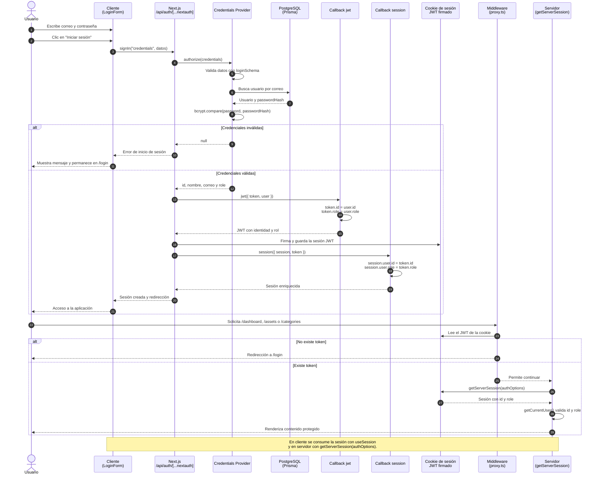

# Diagrama del flujo de autenticación con NextAuth

Este diagrama representa el flujo implementado actualmente en el proyecto:
Credentials Provider, sesiones JWT y validación de sesión en middleware, Server
Components y cliente.

## Lectura del flujo

1. `LoginForm` inicia `signIn` contra el endpoint de NextAuth.
2. `CredentialsProvider` valida el formulario, consulta PostgreSQL mediante
   Prisma y compara la contraseña con `bcryptjs`.
3. El callback `jwt` copia `id` y `role` al token.
4. El callback `session` expone esos datos como `session.user.id` y
   `session.user.role`.
5. `proxy.ts` bloquea las rutas protegidas cuando no hay token.
6. El servidor vuelve a verificar la sesión con `getServerSession`; el
   middleware no sustituye esta comprobación.

Archivos relacionados: [`auth.ts`](../src/lib/auth.ts), [`session.ts`](../src/lib/session.ts),
[`proxy.ts`](../proxy.ts) y [`LoginForm.tsx`](../src/components/auth/LoginForm.tsx).
